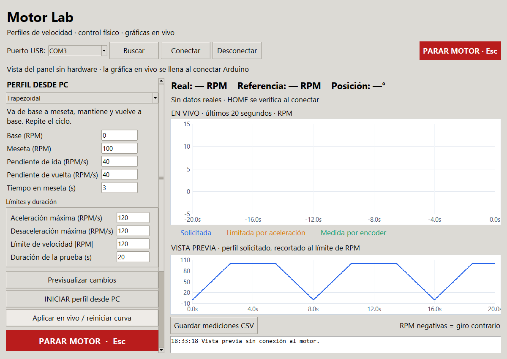

# Microrobótica — Parcial 2

Control de posición y velocidad de un motorreductor GA25-370 con encoder de
cuadratura, Arduino UNO, driver L298N, potenciómetro y pantalla LCD I2C.
Repositorio organizado en Firmware, Simulacion, README.md y .gitignore.

## Organización

```text
microrobotica-parcial-2/
├── Firmware/
│   ├── control_motor/
│   ├── Commi2_Motor/
│   ├── Commit3_Motor/
│   └── Commit4_ControlMotor/
├── Simulacion/
├── README.md
└── .gitignore
```

`Firmware` contiene las versiones Arduino, identificadas con los nombres de
las cuatro carpetas entregadas. `Simulacion` contiene las herramientas de PC
cuando están incluidas en la versión: perfiles matemáticos, vista previa,
gráficas y pruebas. No se recibió un proyecto de simulación mecánica o de circuito.

## Historial de entregas

| Commit / etiqueta | Carpeta de origen | Contenido |
|---|---|---|
| 1 | `control_motor` | Control inicial con potenciómetro, LCD y encoder; conserva la configuración original de esta versión. |
| 2 | `Commi2_Motor` | Firmware con HOME, 880 cuentas/vuelta y protocolo PC. La carpeta recibida contiene únicamente el sketch. |
| 3 | `Commit3_Motor` | Firmware y panel Python con nueve perfiles, previsualización, telemetría y exportación CSV. |
| 4 | `Commit4_ControlMotor` | Entrega final recibida. Sus archivos de programa son idénticos a la entrega 3; cambia el empaquetado original. |

Los commits se incorporaron en ese orden, con etiquetas `v1` a `v4`.
Son instantáneas importadas de las carpetas proporcionadas: las fechas de Git
corresponden a la importación, no a fechas de desarrollo reconstruidas.
Las versiones anteriores permanecen disponibles en sus carpetas y en el historial.
El código fuente se conserva sin modificaciones.

## Componentes

- Arduino UNO R3.
- Motorreductor de 12 V con encoder Hall de cuadratura.
- Driver L298N y fuente externa para el motor, con GND común.
- Potenciómetro lineal de 5 kΩ y LCD 16×2 I2C.
- Pulsadores físicos; las versiones con HOME usan un tercer botón.

## Conexiones de las versiones con HOME

| Arduino | Conexión |
|---|---|
| D2 / D3 | Encoder A / B |
| D4 | Botón de modo a GND |
| D5 | ENA del L298N, sin jumper ENA |
| D7 | Botón marcha/paro y guardar cero a GND |
| D8 / D9 | IN1 / IN2 del L298N |
| D10 | Botón regresar a HOME a GND |
| A0 | Cursor del potenciómetro; extremos a 5V y GND |
| A4 / A5 | SDA / SCL del LCD I2C |

D5 es una señal PWM: no se conecta al pin de alimentación 5V. El motor usa su
fuente externa; los GPIO no alimentan el motor. Revisa el encabezado de cada
sketch porque la primera entrega no tiene el mismo conjunto de funciones.

## Firmware Arduino

Instala la biblioteca **hd44780 de Bill Perry** desde el gestor de bibliotecas.
Abre únicamente el sketch de la versión elegida; selecciona Arduino UNO y
el puerto correcto en Arduino IDE. No mezcles varios sketches de entregas
distintas en una sola carpeta de compilación.

## Ejecutar la entrega 4

1. Carga [`Firmware/Commit4_ControlMotor/motor_perfiles/motor_perfiles.ino`](Firmware/Commit4_ControlMotor/motor_perfiles/motor_perfiles.ino).
2. Cierra el Monitor Serie y Serial Plotter.
3. Ejecuta [`Simulacion/Commit4_ControlMotor/instalar_y_abrir.bat`](Simulacion/Commit4_ControlMotor/instalar_y_abrir.bat).
4. Selecciona el puerto y pulsa **Conectar**. Abrir USB puede reiniciar UNO;
   vuelve a guardar HOME si se pierde.
5. Elige un perfil y pulsa **INICIAR**. Para cambiarlo durante una prueba,
   pulsa **Aplicar en vivo**. **Volver al control físico** devuelve el mando
   al potenciómetro y botones; las gráficas pueden seguir observando.

Se necesita Python 3 con Tk. El lanzador crea `.venv` e instala pyserial con
internet la primera vez. Los entornos virtuales no se incluyen en Git.

Perfiles: constante, rampa lineal, trapezoidal, senoidal, cuadrada, potencia
(llamada exponencial en la guía original), gaussiano, diente de sierra y ruido
uniforme muestreado. Los parámetros se expresan en RPM y RPM/s.



La imagen es una vista del panel, no una prueba del seguimiento físico.
Para detalles de controles y fórmulas, consulta el
[LEEME de la entrega](Simulacion/Commit4_ControlMotor/LEEME.md), teniendo en cuenta que
conserva las rutas internas del paquete original.

## Controles físicos de las últimas entregas

- Potenciómetro: 0–360° en POS; velocidad y sentido en VEL.
- D4: detiene y cambia POS/VEL.
- D7 corto: arranca/detiene en físico; detiene un perfil PC.
- D7 durante 1.5 s, empezando detenido: guarda el cero actual.
- D10: regresa al cero guardado y se detiene.
- Encoder incremental: HOME se pierde al reiniciar; no es homing absoluto.

La calibración de las últimas entregas es 880 cuentas/vuelta. Las ganancias,
alimentación y seguimiento deben validarse con el motor real.

## Alcance de esta importación

Los programas de Commit3_Motor y Commit4_ControlMotor recibidos son iguales;
se preservan ambas entregas y se documenta esa equivalencia. No se atribuye
a la cuarta carpeta una corrección que no esté en sus archivos. En particular,
estos originales mantienen la detección anterior de ausencia de pulsos cerca
de cero; la corrección posterior del gaussiano del chat no se incorpora sin
formar parte de estas cuatro carpetas.

Los archivos VERIFICACION.txt se conservan como documentación recibida.
Este repositorio no afirma que se haya probado el motor físico al importarlo.
